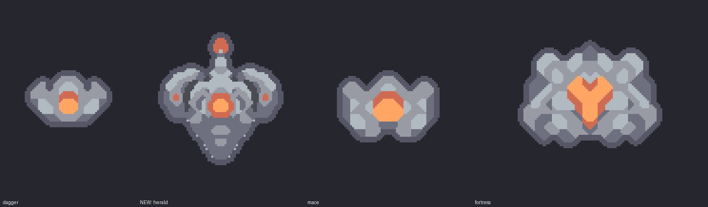

# FanPulse: Herald (Mindustry mod)

Players say guardian bosses arrive without warning ("a sudden HUGE boss after several easy waves"). This mod adds the **Herald**, a light scout from the dagger unit family. Heralds walk in **4, 3 and 2 waves before every guardian boss wave**, on the boss's own schedule, so you can see a boss coming and prepare.

## Install
- **In game:** Mods → Import Mod → choose the downloaded `.zip` of this repo (or "Import from GitHub": `yugena/fanpulse-herald`).
- Restart when asked. The Herald appears in the in-game Database.

## When you'll see it
Heralds only come before **guardian** waves, which appear in *generated* waves (procedural campaign sectors, or generated waves in a custom game). The default waves on regular maps have no guardians. Measured with the game's own wave generator:

| Difficulty | First boss | First Herald |
|---|---|---|
| 0.3 | wave 43–60 | wave 39–56 |
| 0.5 | wave 36–51 | wave 32–47 |
| 0.8 | wave 25–35 | wave 21–31 |
| 1.0 | wave 17–27 | wave 13–23 |

## How it was made and checked
Built with [FanPulse](https://github.com/yugena/fanpulse) from real Steam reviews: the request was found in player feedback, the sprite was generated from a brief based on Mindustry's measured art style and reviewed against the game's own sprites, and the mod was verified inside Mindustry's headless server (v160.8):
- Every guardian wave gets heralds (0% → 100% warned); early waves unchanged.
- Reloading a save doesn't add heralds twice.
- The Herald has 400 health (below 70% of the weakest boss), so it's a preview, not a second boss.

## Credits and license
GPL-3.0, like Mindustry. The Herald's leg and base sprites are Mindustry's mace sprites (© Anuke, GPL-3.0). The body sprite was AI-generated (Canva) and conformed to Mindustry's palette and style rules by FanPulse.
